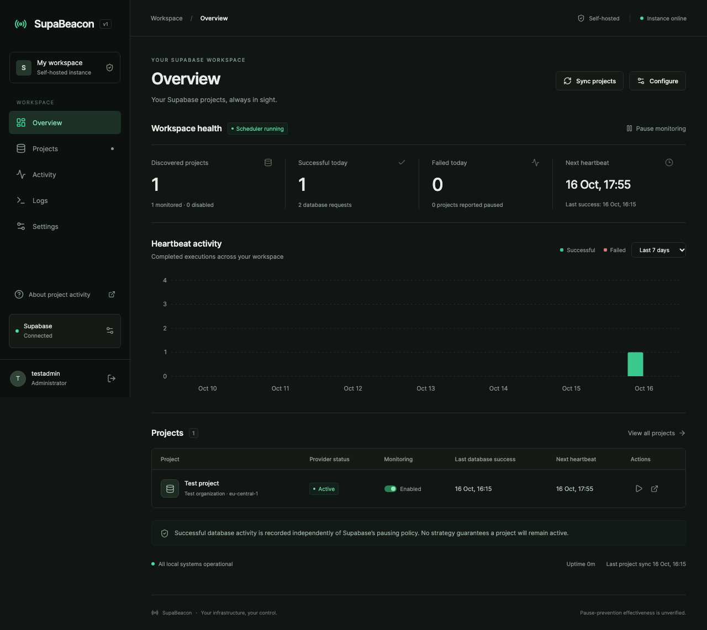

# SupaBeacon


**Your Supabase projects, always in sight.**

[](https://github.com/rafaelreverberi/SupaBeacon/actions/workflows/ci.yml)
[](https://github.com/rafaelreverberi/SupaBeacon/releases/latest)
[](LICENSE)

[Download / Releases](https://github.com/rafaelreverberi/SupaBeacon/releases/latest) · [Docker image](https://github.com/rafaelreverberi/SupaBeacon/pkgs/container/supabeacon) · [Erste Schritte auf Deutsch](docs/erste-schritte.md)

Self-hosted Supabase activity manager with automatic project discovery, scheduled database heartbeats, OAuth integration, and a modern web dashboard.

SupaBeacon runs on your own server in one container. It discovers projects your Supabase integration can access, schedules small read-only database operations, and records exactly what succeeded. No separate Supabase project, Redis, database password, or service-role key is needed.

> Successful database activity **does not guarantee prevention of inactivity pausing**. Supabase Free Plan quotas still apply. Management API read-only queries are Beta, and their effectiveness against pausing has not been verified. SupaBeacon is not affiliated with or endorsed by Supabase.

## What you get

- Management API OAuth with PKCE, encrypted tokens, refresh, reconnect and revocation.
- Automatic project discovery every two hours; new projects inherit configurable defaults.
- Persistent schedules with local-day windows, Europe/Zurich DST support, bounded retries, concurrency limits and no multi-day replay bursts.
- Management API `SELECT 1 AS heartbeat;` by default; optional Data API HEAD requests to an existing safe table using only an existing publishable key.
- Optional per-project bounded GET reads or dedicated test-account sign-in/read/local-sign-out checks; disabled by default. [Configure optional activity](docs/optional-project-activity.md).
- Dark/light dashboard, project configuration, execution details, activity charts, searchable/exportable logs, session management and diagnostics.
- Argon2id administrator passwords, HTTP-only sessions, CSRF protection and authenticated encryption at rest.
- One non-root container, SQLite WAL storage, healthcheck, backup/restore and local-source update scripts.

## Dashboard preview



Preview captured from the test-only server. Production starts empty and never seeds example projects.

**New here?** [Getting started in German / Erste Schritte](docs/erste-schritte.md) · [Detailed OAuth setup](docs/oauth-setup.md) · [What a successful heartbeat proves](docs/project-pausing.md)

## Quick start: Linux / Intel NUC

Requires Docker Engine with Compose v2, Bash, OpenSSL and `ss` or `lsof`. The published Docker image supports **linux/amd64** (Intel/AMD NUC, PC, VPS) and **linux/arm64** (64-bit Raspberry Pi/ARM servers). No host Node.js, npm, database server or compiler is needed for the prebuilt image.

```bash
git clone https://github.com/rafaelreverberi/SupaBeacon.git
cd SupaBeacon
./setup.sh --image
```

No Git? Download **SupaBeacon-v1.0.0.tar.gz** and **SHA256SUMS** from the [release](https://github.com/rafaelreverberi/SupaBeacon/releases/tag/v1.0.0), verify the archive’s SHA-256 against the published checksum, extract it, enter its directory and run `./setup.sh --image`.

The installer pins `ghcr.io/rafaelreverberi/supabeacon:1.0.0` and Docker selects the matching architecture. Prefer a version tag for predictable updates; `latest` is also published. To compile the source locally instead, run `./setup.sh` without `--image`.

Choose a port (default `8080`), network binding, heartbeat settings and timezone. The script generates a private `.env`, pulls the prebuilt image (or builds in source mode) and waits for container health. Open the URL printed by the script, read `SETUP_TOKEN` from `.env`, then create your administrator account. The one-time token cannot create another account after initialization.

Default binding is loopback. When using a remote server, either configure trusted HTTPS or forward a localhost port:

```bash
ssh -L 8080:127.0.0.1:8080 user@your-server
```

Then open `http://localhost:8080` on your own computer. Register that exact localhost callback and keep `APP_URL=http://localhost:8080`. Plain HTTP LAN access is available for administration but is unencrypted; non-loopback HTTP OAuth callbacks are intentionally rejected.

## Register Supabase OAuth

**First time? Follow the [step-by-step OAuth setup guide](docs/oauth-setup.md)** for every form field, permission, credential and connection check. Each self-hosted installation registers its own application once; individual projects need no separate setup.

1. Open your Supabase organization's **Settings → OAuth Apps** and register an application.
2. Register the callback shown under **Settings → Supabase integration**, for example `http://localhost:8080/api/oauth/callback` or `https://beacon.example.com/api/oauth/callback`.
3. Select **Projects Read** (`projects:read`) and **Database Read** (`database:read`) in the registered application. Scopes are configured there, not on the authorization request.
4. Save your **client ID** and **client secret** in the local dashboard, then select **Connect Supabase**.

Optionally upload the included [SupaBeacon logo PNG](apps/web/public/branding/SupaBeacon_Logo.png) in the OAuth registration form. The same file can be downloaded in Settings → Supabase integration.

Each self-hosted administrator provides their own client credentials. There is no embedded public client secret or required hosted broker. See [OAuth setup](docs/oauth-setup.md) for callback routing, permissions and optional Data API access.

## Run, stop and inspect

```bash
./scripts/start.sh             # pull configured image, or build local source
docker compose logs -f --tail=100
docker compose stop             # preserve container and data
docker compose down             # remove container; retain named data volume
```

To change the port later, see [Changing the dashboard port](docs/installation.md#changing-the-dashboard-port-later), including low ports such as 84 and OAuth callback updates.

Docker must start on boot for `restart: unless-stopped` to take effect. The image exposes only container port `8080`; host binding/port come from `.env`.

## Configuration

| Setting                    | Default                          | Where to change                                                                  |
| -------------------------- | -------------------------------- | -------------------------------------------------------------------------------- |
| Heartbeats / project / day | 2 (1–6)                          | Dashboard; per-project override                                                  |
| Requests / heartbeat       | 2 (1–3)                          | Dashboard; per-project override                                                  |
| Randomized schedule        | Enabled                          | Dashboard; fixed local times supported                                           |
| Discovery                  | Every 2 hours                    | Dashboard (1–24 hours)                                                           |
| New-project monitoring     | Enabled                          | Dashboard                                                                        |
| Timezone                   | Detected; fallback Europe/Zurich | Setup/dashboard                                                                  |
| Maximum concurrency        | 2                                | Dashboard (1–5)                                                                  |
| Timeout                    | 15 seconds per HTTP request      | Dashboard (3–60 seconds)                                                         |
| Retries                    | 2 maximum                        | Dashboard (0–3)                                                                  |
| History/log retention      | 30 days                          | Dashboard (7–365 days)                                                           |
| `APP_URL`                  | `http://localhost:8080`          | `.env`; recreate container                                                       |
| `APP_URL_MODE`             | `auto`                           | HTTP follows host port; HTTPS stays fixed; `explicit` preserves the full APP_URL |
| `SUPABEACON_IMAGE`         | Unset in source mode             | `.env`; versioned GHCR image for prebuilt installations                          |
| `DASHBOARD_PORT`           | `8080`                           | `.env`; recreate container                                                       |
| `BIND_ADDRESS`             | `127.0.0.1`                      | `.env`; recreate container                                                       |
| `TRUST_PROXY`              | None                             | Explicit trusted proxy IP/CIDR in `.env`                                         |
| `ENCRYPTION_KEY`           | Random 32 bytes, hex             | Generated once; preserve with backups                                            |
| `SETUP_TOKEN`              | Random                           | First administrator bootstrap only                                               |

Initial heartbeat environment values seed SQLite only on first initialization. Subsequent changes belong in the dashboard. Secrets never belong in Git. Preserve the encryption key with the database or saved OAuth credentials will be unreadable.

## Updates and backups

```bash
./scripts/backup.sh
# Review/check out a trusted new source revision yourself.
./scripts/update.sh
./scripts/restore.sh backups/YOUR-BACKUP.tar.gz
```

Update takes a backup first, then pulls the configured `SUPABEACON_IMAGE` or builds the currently checked-out source. For an image upgrade, change only its version tag in `.env` before running the update script. It never fetches source revisions, pushes or publishes anything. Backups use SQLite's online backup API and include `.env`; archives contain sensitive encryption material and are mode `0600`. Restore requires typing `RESTORE` and takes a safety backup of an existing running instance. See [installation](docs/installation.md).

## Development

Node.js 22.12+ (Docker uses Node.js 24 LTS), npm and a C++ build toolchain if a native SQLite prebuild is unavailable.

```bash
npm ci
npm run init
npm run check
npm run start
```

This serves the built dashboard at `http://localhost:8080`. For frontend development, run `npm run dev` and `npm run dev:web` separately, open Vite's URL, and set `APP_URL` to that exact origin (usually `http://localhost:5173`) and `APP_URL_MODE=explicit` before starting the server. OAuth callbacks are proxied through Vite.

```bash
npx playwright install chromium
npm run test:e2e
```

Backend tests and browser tests use injected, controlled Supabase responses and temporary SQLite databases. No production OAuth credentials are needed. A separate live test using an already-configured instance confirmed the default database query; it did not establish prevention of pausing. Read [verification](docs/verification.md) for exact coverage and live-test limitations.

## FAQ

**Does this guarantee my project will not pause?** No. [Supabase's policy](https://supabase.com/docs/guides/platform/free-project-pausing) concerns sufficient user database activity over a week. It does not specify that this application's read-only Management API queries satisfy the policy. Paid plans are the documented way to avoid inactivity pausing.

**Will it resume a paused project?** No. Only projects reporting `ACTIVE_HEALTHY` are queried. A missing project is marked access unavailable, because missing visibility does not prove deletion.

**Why do I have to register OAuth?** Supabase Management API OAuth requires an application client ID and secret. A universal secret in a public image would be unsafe. An optional external OAuth broker could be designed later; none is implemented or required.

**What does a “request” mean?** The request estimate counts configured heartbeat database requests. Discovery, provider-status checks, optional key lookups, manual executions, authentication refreshes and retries add HTTP requests. Execution details list each attempt and distinguish confirmed database activity from plain HTTP success.

**Can I add more activity per project?** Yes: [Additional activity](docs/optional-project-activity.md) supports up to eight named checks per project, each with its own On/Off switch and expandable editor: bounded real reads or an opt-in dedicated test-account sign-in flow. No users are created/deleted; received row values and Auth tokens are not persisted. It does not guarantee prevention of pausing.

**Can I use any table or RPC?** The normal optional Data API strategy supports existing safe tables using HEAD and `limit=1`. The separate project activity feature uses a bounded GET on one explicitly chosen safe column. Both respect existing RLS. Arbitrary URLs, RPC execution, private table exposure, schema changes and customer-data writes are not supported. RPCs can have side effects, so they are excluded.

**How much memory?** Compose caps the container at 384 MB and one CPU. Actual usage depends on project count and workload. No resource guarantee is made; test your hardware.

## More information

[Installation](docs/installation.md) · [OAuth](docs/oauth-setup.md) · [Architecture](docs/architecture.md) · [API](docs/api.md) · [Security](SECURITY.md) · [Troubleshooting](docs/troubleshooting.md) · [Contributing](CONTRIBUTING.md)

## License

[MIT](LICENSE).
